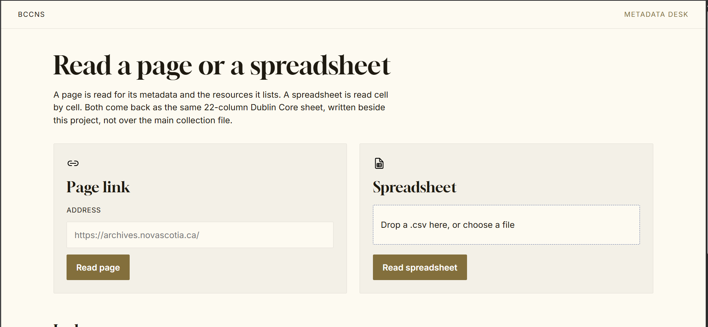

# Data Aggregation Service

This project is a data aggregation service for Main Hackathon Repo. It gathers metadata from public historical and educational sources, standardizes it into a Dublin Core CSV, and includes a local web UI for reviewing, importing, and exporting records.

## Overview

The service reads public pages from Black history collections and extracts item-level metadata such as title, creator, description, subject, date, place, rights, identifier, and source links. Each record is normalized into a consistent Dublin Core schema and exported as a CSV for downstream applications, research workflows, and web display.

The project supports a few core workflows:

- Harvest built-in Black history collections from configured public sources
- Read a single URL and extract records from that page or linked listing
- Convert a prefilled spreadsheet into the project’s Dublin Core format
- Use the included web interface to process a URL or CSV locally

## Included collections

The default aggregation run includes public sources such as:

- Nova Scotia Archives virtual exhibits:
  - African Nova Scotians in the Age of Slavery and Abolition
  - African Nova Scotian Diaspora
  - Africville: Gone but Never Forgotten
  - Viola Desmond
- Additional educational and historical sources:
  - The Canadian Encyclopedia, Black History in Canada
  - A Black People’s History of Canada
  - Black Loyalists: Our Story, Our People
  - Black Loyalist Heritage Centre history pages
  - Library and Archives Canada, Black Canadians research guide

## Project structure

```text
.
├── README.md
├── example.env
├── pyproject.toml
├── scraper/
│   ├── __main__.py          # CLI entry point
│   ├── desk.py              # web UI backend
│   ├── sources.py           # source configuration
│   ├── harvest.py           # fetch and collect records
│   ├── parse.py             # HTML parsing logic
│   ├── import_page.py       # page-based import helpers
│   ├── from_csv.py          # spreadsheet conversion
│   ├── extra.py             # additional source harvesting
│   └── schema.py            # Dublin Core column definitions
├── web/
│   ├── index.html
│   ├── desk.css
│   └── desk.js
├── design/
│   └── assets/icons/
├── output/
│   └── black_history_metadata.csv
└── uv.lock
```

## Requirements

- Python 3.11 or newer
- `uv` for dependency management and running the project scripts

## Installation

From the project root:

```bash
uv sync
```

This installs the project dependencies in `pyproject.toml`.

## Ways to run the service

There are two main ways to use this project:

### 1) Run the web UI

Start the local web interface:

```bash
uv run scrape-desk
```

Then open:

```text
http://127.0.0.1:8765
```

Use the web UI to:

- paste a public page URL
- upload a CSV file
- monitor progress
- preview generated rows
- download the finished Dublin Core CSV
#### Web UI mockup



### 2) Run from the command line

#### Full harvest

```bash
uv run scrape-metadata
```

This runs the built-in collection process and writes output to `output/black_history_metadata.csv`.

#### Quick validation run

```bash
uv run scrape-metadata --limit 2 --copy-to -
```

This limits the run to two records per collection and skips copying the result to a downstream app.

#### Single URL import

```bash
uv run scrape-metadata "https://example.org/some-page"
```

This parses a page URL and extracts records from that source using the project’s import logic.

#### CSV import

```bash
uv run scrape-metadata "./path/to/prefilled.csv"
```

When a CSV path is provided, the service assumes the file already contains metadata and rewrites it into the project’s Dublin Core schema.

## Command-line options

Use the CLI help for more detail:

```bash
uv run scrape-metadata --help
```

Common flags include:

- `--output PATH`: choose a custom output file location
- `--limit N`: maximum number of records per collection
- `--only all|nsa|extra`: restrict the run to Nova Scotia Archives sources or the later sources
- `--copy-to PATH`: copy the generated CSV to another location when needed
- `-` for `--copy-to`: skip the copy step

## Output format

The generated CSV follows the Dublin Core schema defined in `scraper/schema.py`. It includes fields such as:

- `dc_title`
- `dc_creator`
- `dc_description`
- `dc_subject`
- `dc_date`
- `dc_type`
- `dc_identifier`
- `dc_source`
- `dc_relation`
- `collection`
- `media_url`

Each row represents one harvested item. If a field contains multiple values, they are joined with the separator ` | `.


## Notes

- The service targets public pages and reads publicly available information only.
- The project is focused on normalized metadata output rather than duplicating archival collections wholesale.
- By default, the CLI writes results to the local project output directory and can optionally copy the generated file to a downstream application path when configured.

## Typical workflow

1. Install dependencies with `uv sync`
2. Run a full data harvest with `uv run scrape-metadata`
3. Review the generated CSV in `output/black_history_metadata.csv`
4. Optionally copy it into a downstream app with `--copy-to`
5. Use the local web UI with `uv run scrape-desk` for interactive review and export
